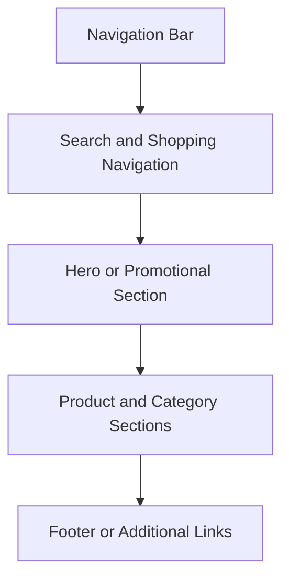

# 🛒 Amazon Clone — E-Commerce Homepage UI

### A Frontend Web Development Project

<p align="center">
  <strong>Recreating the Amazon shopping experience with HTML and CSS.</strong>
</p>

<p align="center">
  
  
  
</p>

---

## 📌 About the Project

**Amazon Clone** is a frontend web development project inspired by the layout and shopping interface of Amazon.

The goal of this project is to recreate key elements of an e-commerce homepage using HTML and CSS while strengthening my understanding of web page structure, styling, layout design, and user interface development.

The project focuses on building a familiar online shopping interface with navigation, product sections, category displays, and a visually organized homepage.

> **Project focus:** Learn by building a recognizable real-world web interface.

## 🎯 Project Objectives

- Understand how real-world e-commerce websites organize their interfaces.
- Build structured web pages using semantic HTML.
- Recreate navigation bars, product sections, and category layouts.
- Use CSS for styling, spacing, alignment, and visual hierarchy.
- Practise layout techniques and reusable styling patterns.
- Strengthen frontend development and UI implementation skills.

## ✨ Key Features

### 🧭 1. Navigation Bar
An Amazon-inspired navigation area designed to organize the shopping interface and provide easy access to different sections.

### 🔎 2. Search Interface
A search bar styled to resemble an online shopping search experience.

### 🛍️ 3. Product Display Sections
Product-oriented sections arranged in a grid or card-based layout to showcase items visually.

### 🗂️ 4. Category-Based Layout
Organized content sections inspired by the category browsing experience of e-commerce platforms.

### 🎨 5. Amazon-Inspired Styling
A familiar visual design using contrasting colors, structured sections, spacing, and typography.

### 📐 6. CSS Layout Practice
Hands-on practice with CSS positioning, alignment, dimensions, spacing, and page composition.

*The features above describe the intended interface. Interactive search, working product data, cart operations, checkout, and authentication are not implied unless separately implemented.*

## 🖥️ Technologies Used

| Technology | Purpose |
|---|---|
| HTML5 | Page structure and content |
| CSS3 | Styling, layout, colors, and visual design |

## 🏗️ How the Page Is Organized

The intended homepage layout follows a typical e-commerce browsing experience:



This diagram represents the general page layout, not a claim that every section is present in the current code.

## 📂 Project Structure

A typical structure for this project is:

```text
amazon-clone/
├── index.html
├── style.css
└── images/
    └── product and banner images
```

Your actual filenames and folders may differ.

## 🚀 How to Run the Project

No backend server or package installation is required for a basic HTML/CSS implementation.

### Option 1: Open in a browser

1. Download or clone the repository.
2. Open the project folder.
3. Open `index.html` in your browser.

### Option 2: Use VS Code

1. Open the project folder in VS Code.
2. Open `index.html`.
3. Use the Live Server extension if you want automatic browser refresh while editing.

## 🧠 What I Learned

Through this project, I practised:

- Writing structured HTML.
- Styling web pages with CSS.
- Creating navigation and content sections.
- Working with CSS positioning and alignment.
- Organizing product cards and category layouts.
- Understanding the visual structure of e-commerce websites.
- Translating a familiar website design into a frontend implementation.
- Debugging layout and styling issues.

## 📚 Interview Revision Checklist

Use this section to revise the fundamentals behind the project.

- [ ] **HTML:** Elements, attributes, semantic tags, links, images, and forms.
- [ ] **CSS selectors:** Element, class, ID, and descendant selectors.
- [ ] **Box model:** Content, padding, border, and margin.
- [ ] **Layout:** Flexbox, Grid, positioning, and alignment.
- [ ] **Typography:** Font families, sizes, weights, and text spacing.
- [ ] **Responsive design:** Media queries and flexible layouts, if implemented.
- [ ] **Asset management:** Image paths and organizing static resources.
- [ ] **Accessibility:** Meaningful labels, alternative text, and semantic structure.

**Interview tip:** Be prepared to explain how you structured the page, which CSS techniques you used, how you arranged product sections, and what you would improve to make the interface responsive and interactive.

## 🔮 Future Improvements

Possible next steps include:

- Making the layout responsive across mobile, tablet, and desktop.
- Adding JavaScript-powered search and category filters.
- Implementing product detail pages.
- Adding a functional shopping cart.
- Connecting a backend and database for product data.
- Introducing user authentication and order management.

These are potential enhancements, not claims about the current implementation.

## 👩‍💻 Author

**Jagrati Mishra**

- GitHub: [@jagratimishra05](https://github.com/jagratimishra05)

---

<p align="center">
  <strong>Building interfaces. Practising fundamentals. Growing as a developer.</strong>
</p>
